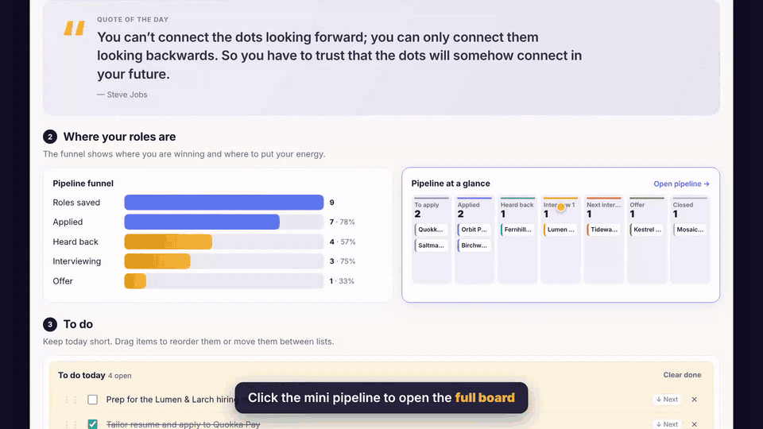

# Job Search HQ

**One page for your whole job search: every role, interview, follow-up and bit of company research, with Claude doing the heavy lifting.**

I built this while working through my own redundancy. Spreadsheets didn't show me what to do *today*, so I made a board that does. Copy it and make it yours.

> Everything in the demo is fictional example data. Click **Reset demo** any time, or delete the example roles and add your own.

---

## What's inside

| | |
|---|---|
| **Overview** | A quote of the day, your pipeline funnel, a clickable mini pipeline, and a *To do today / To do next* list you reorder by dragging |
| **Pipeline** | A drag-and-drop board from *To apply* through to *Offer*, with a fit score and next step on every card |
| **Each role** | Company brief, your resume, the job description, interview prep (likely questions, questions to ask them, STAR stories), notes and steps |
| **Story bank** | Write each story once in STAR format (Situation, Task, Action, Result) and reuse it in every interview |
| **Network** | Keep every conversation and follow-up moving |
| **Connect & sync** | Your master CV, Gmail reply spotting, Google Calendar and Drive, plus import from and export to [career-ops](https://github.com/santifer/career-ops) |

### The Claude features
When the board runs as a **Claude artifact** (see option 1 below), Claude can:
- **research a company** as soon as you add it
- **score your fit** from 1 to 5 against the job description (*Worth applying*, *Good fit*, *Consider skipping*) and flag possible ghost jobs
- **write likely interview questions** from the job description
- **pull interviews from Google Calendar**, **read your CV from Google Drive**, and **spot replies in Gmail** (rejections, interview invites, next steps), then suggest which stage each role should move to
- **draft recruiter messages** and save them as Gmail drafts

Nothing is ever sent or submitted for you. You stay in control.

---

## How to use it

### Option 1: run it inside Claude (recommended, with all the AI features)
1. Download [`index.html`](index.html), using **Download raw file** on that page.
2. Open [claude.ai](https://claude.ai), start a chat and attach the file.
3. Ask: *"Publish this as an artifact for me."*
4. Open the artifact, then connect Gmail, Google Calendar and Google Drive under **Settings → Connectors** if you want those features. The board asks your permission the first time it uses Claude or a connector.

### Option 2: just open the file (no AI, still fully usable)
Download `index.html` and open it in any browser. The board, to-dos, story bank and network all work, and your data saves in that browser. The Claude buttons switch to **Copy prompt**, so you can paste a ready-made prompt into Claude yourself.

*Back up or move your data any time with **Copy / load data** in the top bar.*

---

## Works with career-ops
[career-ops](https://github.com/santifer/career-ops) is a popular open-source Claude Code system that scans job boards, scores roles and tailors CVs from your terminal. Use career-ops as the engine and this board as the visual dashboard:

- **Import:** in **Connect & sync**, upload career-ops' `data/applications.md`. Roles, scores and stages come across, and existing roles are updated rather than duplicated.
- **Export:** download a CSV and run `node import-tracker.mjs hq-export.csv` in your career-ops folder. Check the preview, then run it again with `--confirm`.

---

## Make it yours
It's a single HTML file with no build step and no dependencies. Change the stages, colours, quotes or example data straight in `index.html`, or ask Claude to do it: *"Add a 'Take-home task' stage between Interview 1 and Next interviews."*

## Privacy
Your data stays in your browser, or in your own Claude artifact. Nothing is sent anywhere unless you use a Claude or connector feature, and those run under your own account and ask your permission first.

## License
[MIT](LICENSE). Free to use, copy, change and share.

---
Built by Diana Bradley with [Claude](https://claude.ai).
